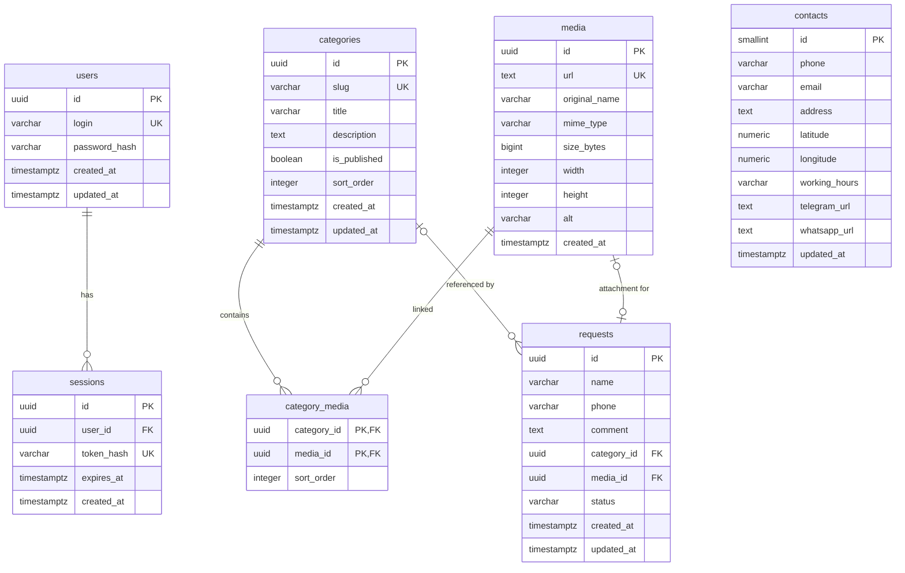

# Схема базы данных — сайт производства полиуретановых изделий
**Стек:** PostgreSQL 18 · FastAPI · SQLAlchemy 2 (async) · asyncpg · Alembic · SeaweedFS (S3 API)

**Статус:** целевая схема MVP (контракт из согласованного документа; сопоставить со стартером перед миграциями)


> **Важно для Codex:** этот документ задаёт целевую предметную схему, а **не** описывает текущее состояние БД в репозитории. Источник кода — [raiselfg/poli-backend](https://github.com/raiselfg/poli-backend). Сначала прочитай его `AGENTS.md`, модели и миграции Alembic; не запускай приведённый ниже DDL поверх существующей схемы. Совместимость проверяется отдельными миграциями, а не пересозданием `users`/`sessions`.
>
> Не добавлять `products`, корзину, покупки, роли и универсальную CMS. Категории — разделы **одной страницы**; заявки сохраняются в БД и могут отправлять уведомления в Telegram.


## 1. Обзор

Схема содержит **7 таблиц, 49 полей и 5 внешних ключей**.

| **Таблица** |  **Полей** |  **Назначение** |
| --- | --- | --- |
| `users` |  5 |  Пользователи административной панели |
| `sessions` |  5 |  Серверные сессии пользователей |
| `categories` |  8 |  Категории продукции |
| `media` |  9 |  Метаданные изображений и файлов заявок, хранящихся в SeaweedFS |
| `category_media` |  3 |  Связь M:N между категориями и изображениями, порядок в галерее |
| `contacts` |  10 |  Контактные данные компании (одна запись) |
| `requests` |  9 |  Заявки клиентов, статусы и ссылка на один файл из `media` |


**Не входят в БД:** тексты лендинга (хранятся в Next.js), отдельные товары, роли и регистрация пользователей. Заявки сохраняются в `requests`, а **максимум одно необязательное вложение** ссылается по `requests.media_id` на запись общей таблицы `media`. Сам файл хранится в **приватном S3-бакете SeaweedFS**. `media.url` для такого файла ведёт только на защищённый маршрут API (не на публичный объект SeaweedFS).


## 2. ER-диаграмма





## 3. Таблицы


### 3.1. `users` — пользователи админки

| **Поле** |  **Тип PostgreSQL** |  **Ограничения / значение по умолчанию** |
| --- | --- | --- |
| `id` |  `UUID` |  `PRIMARY KEY DEFAULT gen_random_uuid()` |
| `login` |  `VARCHAR(50)` |  `NOT NULL UNIQUE` |
| `password_hash` |  `VARCHAR(255)` |  `NOT NULL` |
| `created_at` |  `TIMESTAMPTZ` |  `NOT NULL DEFAULT now()` |
| `updated_at` |  `TIMESTAMPTZ` |  `NOT NULL DEFAULT now()` |


- Авторизация по **логину и паролю**, не по email.
- Логин хранится в нижнем регистре, не может быть пустым.
- Пароль хранится как Argon2id-хеш; публичной регистрации и ролей для MVP нет.
- Пользователи создаются через seed или CLI.
- Связь: `users.id → sessions.user_id` (**1:N**).

**Индексы:** `users_pkey` (`id`, PK); `users_login_key` (`login`, UNIQUE).

### 3.2. `sessions` — серверные сессии

| **Поле** |  **Тип PostgreSQL** |  **Ограничения / значение по умолчанию** |
| --- | --- | --- |
| `id` |  `UUID` |  `PRIMARY KEY DEFAULT gen_random_uuid()` |
| `user_id` |  `UUID` |  `NOT NULL`, FK на `users.id` |
| `token_hash` |  `VARCHAR(64)` |  `NOT NULL UNIQUE` |
| `expires_at` |  `TIMESTAMPTZ` |  `NOT NULL` |
| `created_at` |  `TIMESTAMPTZ` |  `NOT NULL DEFAULT now()` |


- Один пользователь может иметь несколько действующих сессий.
- В БД хранится SHA-256-хеш криптографически случайного токена; оригинал — в защищённой HttpOnly cookie браузера.
- При выходе сессия удаляется, просроченные сессии очищаются периодически.
- FK: `user_id REFERENCES users(id) ON DELETE CASCADE`.

**Индексы:** `sessions_pkey` (`id`, PK); `sessions_token_hash_key` (`token_hash`, UNIQUE); `idx_sessions_user_id` (`user_id`); `idx_sessions_expires_at` (`expires_at`).

### 3.3. `categories` — категории продукции

| **Поле** |  **Тип PostgreSQL** |  **Ограничения / значение по умолчанию** |
| --- | --- | --- |
| `id` |  `UUID` |  `PRIMARY KEY DEFAULT gen_random_uuid()` |
| `slug` |  `VARCHAR(120)` |  `NOT NULL UNIQUE` |
| `title` |  `VARCHAR(160)` |  `NOT NULL` |
| `description` |  `TEXT` |  `NOT NULL DEFAULT ''` |
| `is_published` |  `BOOLEAN` |  `NOT NULL DEFAULT false` |
| `sort_order` |  `INTEGER` |  `NOT NULL DEFAULT 0` |
| `created_at` |  `TIMESTAMPTZ` |  `NOT NULL DEFAULT now()` |
| `updated_at` |  `TIMESTAMPTZ` |  `NOT NULL DEFAULT now()` |


- `slug` имеет формат `vtulki`, `poliuretanovye-vtulki` и используется как стабильный идентификатор на сайте.
- Публичный API возвращает только `is_published = true`.
- `sort_order` задаёт порядок категорий; значения могут совпадать, тогда дополнительно сортируем по `id`.
- `title` не может быть пустым, `slug` соответствует регулярному выражению `^[a-z0-9]+(-[a-z0-9]+)*$`, `sort_order >= 0`.
- Связь с `media`: **M:N** через `category_media`.

**Индексы:** `categories_pkey` (`id`, PK); `categories_slug_key` (`slug`, UNIQUE); `idx_categories_sort_order` (`sort_order`, `id`).

### 3.4. `media` — медиатека

| **Поле** |  **Тип PostgreSQL** |  **Ограничения / значение по умолчанию** |
| --- | --- | --- |
| `id` |  `UUID` |  `PRIMARY KEY DEFAULT gen_random_uuid()` |
| `url` |  `TEXT` |  `NOT NULL UNIQUE` |
| `original_name` |  `VARCHAR(255)` |  `NOT NULL` |
| `mime_type` |  `VARCHAR(100)` |  `NOT NULL` |
| `size_bytes` |  `BIGINT` |  `NOT NULL`, больше 0 |
| `width` |  `INTEGER` |  `NULL`, если задано — больше 0 |
| `height` |  `INTEGER` |  `NULL`, если задано — больше 0 |
| `alt` |  `VARCHAR(200)` |  `NULL` |
| `created_at` |  `TIMESTAMPTZ` |  `NOT NULL DEFAULT now()` |


- В БД хранятся **метаданные**; файлы находятся в SeaweedFS. Разрешены изображения каталога и приватные вложения заявок (например, PDF/DWG). Для не-изображений `width` и `height` равны `NULL`.
- `url` — полный постоянный HTTPS-адрес. Для фотографий категорий это публичный URL; для файла заявки — **защищённый URL API**, требующий сессию администратора (например, `https://api.example.ru/api/v1/admin/requests/{requestId}/file`). Прямых общедоступных ссылок на приватный бакет нет.
- При сохранении файла заявки внутренний ключ приватного объекта формируется **детерминированно из ID медиа**, например `requests/{mediaId}`. Поэтому он не требует отдельного столбца `storage_key`; сервер находит объект по `media.id` и конфигурации приватного бакета.
- `GET /api/v1/admin/media` показывает медиатеку сайта, **не включая** прикреплённые к заявкам файлы. Нельзя добавить файл заявки в галерею категории, изменить его через `PATCH /api/v1/admin/media/{id}` или удалить через общий `DELETE /api/v1/admin/media/{id}`. Эти правила проверяются сервисом.
- При изменении домена потребуется обновить сохранённые `url`; нельзя путать URL ответа API и внутренний S3 endpoint. Нельзя хранить временные presigned-ссылки как постоянные URL.
- `size_bytes > 0`; необязательные `width`, `height` положительны при наличии.

**Индексы:** `media_pkey` (`id`, PK); `media_url_key` (`url`, UNIQUE).

### 3.5. `category_media` — изображения категорий

| **Поле** |  **Тип PostgreSQL** |  **Ограничения / значение по умолчанию** |
| --- | --- | --- |
| `category_id` |  `UUID` |  `NOT NULL`, часть составного PK, FK на `categories.id` |
| `media_id` |  `UUID` |  `NOT NULL`, часть составного PK, FK на `media.id` |
| `sort_order` |  `INTEGER` |  `NOT NULL DEFAULT 0`, больше либо равно 0 |


- **Составной первичный ключ:** (`category_id`, `media_id`). Дополнительного `id` нет.
- Фото не может повторяться в одной категории, но может использоваться в разных.
- `sort_order` задаёт порядок **в пределах конкретной категории**. При равных значениях можно дополнительно сортировать по `media_id`.
- Удаление категории удаляет записи связи: `ON DELETE CASCADE`.
- Удаление медиа, пока существуют связи, запрещается: `ON DELETE RESTRICT`.
- Удаление связи **не удаляет физический файл**.

**Индексы:** `category_media_pkey` (`category_id`, `media_id`, PK); `idx_category_media_order` (`category_id`, `sort_order`); `idx_category_media_media_id` (`media_id`).

### 3.6. `contacts` — контакты производства

| **Поле** |  **Тип PostgreSQL** |  **Ограничения / значение по умолчанию** |
| --- | --- | --- |
| `id` |  `SMALLINT` |  `PRIMARY KEY DEFAULT 1`, `CHECK (id = 1)` |
| `phone` |  `VARCHAR(40)` |  `NOT NULL` |
| `email` |  `VARCHAR(254)` |  `NULL` |
| `address` |  `TEXT` |  `NOT NULL` |
| `latitude` |  `NUMERIC(9,6)` |  `NULL`, в диапазоне −90…90 |
| `longitude` |  `NUMERIC(9,6)` |  `NULL`, в диапазоне −180…180 |
| `working_hours` |  `VARCHAR(255)` |  `NULL` |
| `telegram_url` |  `TEXT` |  `NULL` |
| `whatsapp_url` |  `TEXT` |  `NULL` |
| `updated_at` |  `TIMESTAMPTZ` |  `NOT NULL DEFAULT now()` |


- Единственная логическая запись: **`id = 1`**. Она создаётся при первоначальном развёртывании и изменяется через админку.
- `company_name` **отсутствует** по согласованному решению.
- Широта и долгота либо заданы одновременно, либо обе `NULL`.
- `CHECK (id = 1)` допускает не больше одной записи, но **не гарантирует её наличие**: первичное создание обеспечивает seed/миграция.

**Индекс:** `contacts_pkey` (`id`, PK). Внешних ключей нет.

### 3.7. `requests` — заявки клиентов

| **Поле** |  **Тип PostgreSQL** |  **Ограничения / значение по умолчанию** |
| --- | --- | --- |
| `id` |  `UUID` |  `PRIMARY KEY DEFAULT gen_random_uuid()` |
| `name` |  `VARCHAR(100)` |  `NOT NULL`, непустое имя |
| `phone` |  `VARCHAR(40)` |  `NOT NULL`, непустой телефон |
| `comment` |  `TEXT` |  `NULL` |
| `category_id` |  `UUID` |  `NULL`, FK на `categories.id` |
| `media_id` |  `UUID` |  `NULL`, `UNIQUE`, FK на `media.id` — **не более одного вложения** |
| `status` |  `VARCHAR(20)` |  `NOT NULL DEFAULT 'new'`, значения: `new`, `in_progress`, `completed` |
| `created_at` |  `TIMESTAMPTZ` |  `NOT NULL DEFAULT now()` |
| `updated_at` |  `TIMESTAMPTZ` |  `NOT NULL DEFAULT now()` |


- `category_id` необязателен; при удалении категории становится `NULL` (`ON DELETE SET NULL`), сама заявка остаётся.
- `media_id` необязателен (`NULL` означает заявку **без вложения**) и ссылается на единственную запись `media`. Уникальность `media_id` не позволяет привязать один файл сразу к нескольким заявкам (несколько `NULL` разрешены).
- При попытке удалить `media`, используемое заявкой, внешний ключ запрещает удаление: `ON DELETE RESTRICT`. Это защищает данные заявки.
- Файл из заявки хранится в приватном S3-бакете SeaweedFS. Его `media.url` — защищённый HTTPS-адрес административного скачивания, а не общедоступная ссылка или presigned URL.
- `status` нужен для обработки заявок: новая, в работе, обработана.
- Поле `email` в заявке отсутствует. Email компании остаётся в `contacts`.
- Для заполнения `media_id` приложение при `POST /api/v1/requests` создаёт метаданные файла в `media` и связывает их с новой заявкой. Нельзя создавать файл, доступный через публичную галерею.
- Поиск/скачивание вложения выполняется только после проверки административной сессии. В ответе на публичный `POST /api/v1/requests` нельзя отдавать приватный URL.

**Индексы:** `requests_pkey` (`id`, PK); `requests_media_id_key` (`media_id`, UNIQUE); `idx_requests_created_at` (`created_at DESC`, `id DESC`); `idx_requests_status_created_at` (`status`, `created_at DESC`); `idx_requests_category_id` (`category_id`).

## 4. Сводка индексов

| **Таблица** |  **Индекс** |  **Поля** |  **Тип** |
| --- | --- | --- | --- |
| `users` |  `users_pkey` |  `id` |  PK |
| `users` |  `users_login_key` |  `login` |  UNIQUE |
| `sessions` |  `sessions_pkey` |  `id` |  PK |
| `sessions` |  `sessions_token_hash_key` |  `token_hash` |  UNIQUE |
| `sessions` |  `idx_sessions_user_id` |  `user_id` |  Обычный |
| `sessions` |  `idx_sessions_expires_at` |  `expires_at` |  Обычный |
| `categories` |  `categories_pkey` |  `id` |  PK |
| `categories` |  `categories_slug_key` |  `slug` |  UNIQUE |
| `categories` |  `idx_categories_sort_order` |  `sort_order`, `id` |  Обычный |
| `media` |  `media_pkey` |  `id` |  PK |
| `media` |  `media_url_key` |  `url` |  UNIQUE |
| `category_media` |  `category_media_pkey` |  `category_id`, `media_id` |  Составной PK |
| `category_media` |  `idx_category_media_order` |  `category_id`, `sort_order` |  Обычный |
| `category_media` |  `idx_category_media_media_id` |  `media_id` |  Обычный |
| `contacts` |  `contacts_pkey` |  `id` |  PK |
| `requests` |  `requests_pkey` |  `id` |  PK |
| `requests` |  `requests_media_id_key` |  `media_id` |  UNIQUE |
| `requests` |  `idx_requests_created_at` |  `created_at DESC`, `id DESC` |  Обычный |
| `requests` |  `idx_requests_status_created_at` |  `status`, `created_at DESC` |  Обычный |
| `requests` |  `idx_requests_category_id` |  `category_id` |  Обычный |


**Итого: 20 индексов:** 7 PK, 5 UNIQUE и 8 обычных. PostgreSQL автоматически создаёт индексы для `PRIMARY KEY` и `UNIQUE`: отдельно создавать их не нужно.

## 5. Сводка внешних ключей

| **Таблица** |  **Столбец** |  **Ссылка** |  **При удалении** |
| --- | --- | --- | --- |
| `sessions` |  `user_id` |  `users.id` |  `CASCADE` |
| `category_media` |  `category_id` |  `categories.id` |  `CASCADE` |
| `category_media` |  `media_id` |  `media.id` |  `RESTRICT` |
| `requests` |  `category_id` |  `categories.id` |  `SET NULL` |
| `requests` |  `media_id` |  `media.id` |  `RESTRICT` |

## 6. SQL DDL для PostgreSQL 18

Ниже пример DDL, соответствующий согласованной схеме. Это **справочный DDL целевой схемы**, не готовая миграция для уже существующего стартера. Изменения структуры выполнять новыми миграциями Alembic на основе текущих моделей и ревизий.
```sql
-- USERS
 CREATE TABLE users (
     id UUID PRIMARY KEY DEFAULT gen_random_uuid(),
     login VARCHAR(50) NOT NULL UNIQUE,
     password_hash VARCHAR(255) NOT NULL,
     created_at TIMESTAMPTZ NOT NULL DEFAULT now(),
     updated_at TIMESTAMPTZ NOT NULL DEFAULT now(),
     CONSTRAINT chk_users_login CHECK (
         length(btrim(login)) > 0 AND login = lower(login)
     )
 );

 -- SESSIONS
 CREATE TABLE sessions (
     id UUID PRIMARY KEY DEFAULT gen_random_uuid(),
     user_id UUID NOT NULL,
     token_hash VARCHAR(64) NOT NULL UNIQUE,
     expires_at TIMESTAMPTZ NOT NULL,
     created_at TIMESTAMPTZ NOT NULL DEFAULT now(),
     CONSTRAINT fk_sessions_user FOREIGN KEY (user_id)
         REFERENCES users(id) ON DELETE CASCADE
 );
 CREATE INDEX idx_sessions_user_id ON sessions (user_id);
 CREATE INDEX idx_sessions_expires_at ON sessions (expires_at);

 -- CATEGORIES
 CREATE TABLE categories (
     id UUID PRIMARY KEY DEFAULT gen_random_uuid(),
     slug VARCHAR(120) NOT NULL UNIQUE,
     title VARCHAR(160) NOT NULL,
     description TEXT NOT NULL DEFAULT '',
     is_published BOOLEAN NOT NULL DEFAULT false,
     sort_order INTEGER NOT NULL DEFAULT 0,
     created_at TIMESTAMPTZ NOT NULL DEFAULT now(),
     updated_at TIMESTAMPTZ NOT NULL DEFAULT now(),
     CONSTRAINT chk_categories_slug
         CHECK (slug ~ '^[a-z0-9]+(-[a-z0-9]+)*$'),
     CONSTRAINT chk_categories_title
         CHECK (length(btrim(title)) > 0),
     CONSTRAINT chk_categories_sort_order
         CHECK (sort_order >= 0)
 );
 CREATE INDEX idx_categories_sort_order ON categories (sort_order, id);

 -- MEDIA
 CREATE TABLE media (
     id UUID PRIMARY KEY DEFAULT gen_random_uuid(),
     url TEXT NOT NULL UNIQUE,
     original_name VARCHAR(255) NOT NULL,
     mime_type VARCHAR(100) NOT NULL,
     size_bytes BIGINT NOT NULL,
     width INTEGER,
     height INTEGER,
     alt VARCHAR(200),
     created_at TIMESTAMPTZ NOT NULL DEFAULT now(),
     CONSTRAINT chk_media_url CHECK (url ~ '^https?://'),
     CONSTRAINT chk_media_size CHECK (size_bytes > 0),
     CONSTRAINT chk_media_width CHECK (width IS NULL OR width > 0),
     CONSTRAINT chk_media_height CHECK (height IS NULL OR height > 0)
 );

 -- CATEGORY_MEDIA
 CREATE TABLE category_media (
     category_id UUID NOT NULL,
     media_id UUID NOT NULL,
     sort_order INTEGER NOT NULL DEFAULT 0,
     CONSTRAINT category_media_pkey PRIMARY KEY (category_id, media_id),
     CONSTRAINT fk_category_media_category FOREIGN KEY (category_id)
         REFERENCES categories(id) ON DELETE CASCADE,
     CONSTRAINT fk_category_media_media FOREIGN KEY (media_id)
         REFERENCES media(id) ON DELETE RESTRICT,
     CONSTRAINT chk_category_media_sort_order CHECK (sort_order >= 0)
 );
 CREATE INDEX idx_category_media_order
     ON category_media (category_id, sort_order);
 CREATE INDEX idx_category_media_media_id
     ON category_media (media_id);

 -- CONTACTS
 CREATE TABLE contacts (
     id SMALLINT PRIMARY KEY DEFAULT 1,
     phone VARCHAR(40) NOT NULL,
     email VARCHAR(254),
     address TEXT NOT NULL,
     latitude NUMERIC(9,6),
     longitude NUMERIC(9,6),
     working_hours VARCHAR(255),
     telegram_url TEXT,
     whatsapp_url TEXT,
     updated_at TIMESTAMPTZ NOT NULL DEFAULT now(),
     CONSTRAINT chk_contacts_singleton CHECK (id = 1),
     CONSTRAINT chk_contacts_coordinates CHECK (
         (latitude IS NULL AND longitude IS NULL)
         OR (latitude IS NOT NULL AND longitude IS NOT NULL)
     ),
     CONSTRAINT chk_contacts_latitude CHECK (latitude BETWEEN -90 AND 90),
     CONSTRAINT chk_contacts_longitude CHECK (longitude BETWEEN -180 AND 180)
 );

 -- REQUESTS
 CREATE TABLE requests (
     id UUID PRIMARY KEY DEFAULT gen_random_uuid(),
     name VARCHAR(100) NOT NULL,
     phone VARCHAR(40) NOT NULL,
     comment TEXT,
     category_id UUID,
     media_id UUID UNIQUE,
     status VARCHAR(20) NOT NULL DEFAULT 'new',
     created_at TIMESTAMPTZ NOT NULL DEFAULT now(),
     updated_at TIMESTAMPTZ NOT NULL DEFAULT now(),
     CONSTRAINT fk_requests_category FOREIGN KEY (category_id)
         REFERENCES categories(id) ON DELETE SET NULL,
     CONSTRAINT fk_requests_media FOREIGN KEY (media_id)
         REFERENCES media(id) ON DELETE RESTRICT,
     CONSTRAINT chk_requests_name CHECK (length(btrim(name)) > 0),
     CONSTRAINT chk_requests_phone CHECK (length(btrim(phone)) > 0),
     CONSTRAINT chk_requests_status CHECK (status IN ('new', 'in_progress', 'completed'))
 );
 CREATE INDEX idx_requests_created_at
     ON requests (created_at DESC, id DESC);
 CREATE INDEX idx_requests_status_created_at
     ON requests (status, created_at DESC);
 CREATE INDEX idx_requests_category_id ON requests (category_id);

```


## 7. Правила приложения

1. **`updated_at`:** `DEFAULT now()` действует при `INSERT`, но не при `UPDATE`. SQLAlchemy-сервис/ORM должен обновлять это поле при каждом изменении либо нужно настроить триггер в PostgreSQL.
2. **Сессии:** защищённая cookie (`HttpOnly`, `Secure` в HTTPS, подходящий `SameSite`); проверка сессий, защита от CSRF и очистка истёкших записей выполняются на уровне приложения.
3. **Медиа:** удаление связи `category_media` не удаляет объект из SeaweedFS. Удалять `media`, связанную с `category_media` **или** с `requests.media_id`, запрещено внешними ключами. Для файлов заявок используем только приватный бакет и защищённый маршрут, не публичный CDN.
4. **Сортировка:** при массовом изменении `sort_order` категориям и связям выставляется порядок в рамках транзакции.
5. **Контакты:** запись `contacts(id = 1)` нужно создать при развёртывании. Через админку редактирование разрешено, создание/удаление — нет.
6. **Публичный каталог:** выдаются только опубликованные категории с упорядоченными изображениями; запросы не должны вызывать N+1.
7. **Заявки:** публичное `POST /api/v1/requests` принимает контактные данные и **максимум один** необязательный файл (`file`). Приложение создаёт медиа-запись для него, загружает объект в приватное хранилище SeaweedFS и сохраняет `requests.media_id`. При сбое надо очищать загруженный объект и откатывать изменения БД: транзакция PostgreSQL не охватывает SeaweedFS.
8. **Уведомления:** отправка сообщения в Telegram/email выполняется отдельно и не должна превращать успешно сохранённую заявку в ошибку для пользователя. `email` из заявки не требуется: адрес для уведомлений задаётся на сервере.
9. **Доступ к вложению:** `GET /api/v1/admin/requests/{id}/file` работает только после проверки сессии; по `requests.media_id` находится `media` и приватный объект. URL из `media` для такого файла не должен быть доступен без авторизации. Допускается только **одно** вложение; проверку размера, формата и безопасности выполняет приложение. Удаление заявок/вложений и сроки хранения файлов согласуются отдельно.


## 8. Сопоставление с существующим FastAPI-стартером


**Проверено по публичной ветке `main` `raiselfg/poli-backend` на 11.11.2026; код в твоей рабочей ветке может отличаться.** В стартере используются FastAPI, SQLAlchemy 2 async, asyncpg, Alembic, Pydantic v2 и серверные cookie-сессии. Базовый маршрут API — `/api/v1`.


### 8.1. Расхождения в уже существующих таблицах


- В целевом документе `users` имеет **5 полей** и `login VARCHAR(50)`, `password_hash VARCHAR(255)`, `updated_at`. В проверенной модели стартера `User` определён с **4 полями**: `id`, `login` (`String(32)`), `password_hash` (`String(512)`), `created_at`. Следовательно, блок `CREATE TABLE users` выше **не равен** текущей модели.
- В целевой таблице `sessions` есть `created_at`; существующая модель `Session` в публичной ветке содержит `id`, `user_id`, `token_hash`, `expires_at` (без `created_at`). Имена существующих индексов/уникальных ограничений тоже могут отличаться от справочных имён ниже.
- Правило: **не менять авторизацию и базовые модели ради совпадения с этой схемой автоматически**. Сначала изучить актуальные ревизии Alembic и решить, действительно ли нужны отличающиеся поля. До такого решения использовать существующие имена колонок и ограничения как источник истины для реализации.
- Таким образом, **«7 таблиц, 49 полей, 5 FK» — характеристика приложенной целевой схемы**, а не заявление о текущей или автоматически получающейся схеме после добавления бизнес-таблиц в стартер. Если сохраняем текущие `users`/`sessions`, итоговое число полей отличается.


### 8.2. Миграции и ORM


- ORM-модели — `app/models`, миграции — `alembic/versions`. Новые категории, медиа, связи, контакты и заявки создаются **новыми Alembic-ревизиями**; существующие `users` и `sessions` не дублировать.
- `UUID` в SQLAlchemy — тип `Uuid(as_uuid=True)` или подходящий диалектный UUID в стиле текущего проекта. Использовать миграции для серверных `DEFAULT`, `CHECK`, `FK`, индексов и составного PK.
- Доступ к данным сохраняет цепочку `router → service → repository → PostgreSQL`. Только репозитории составляют/выполняют SQLAlchemy-запросы; сервисы контролируют транзакции `commit/rollback`, включая операции над несколькими таблицами.
- Для выборки публичных категорий с изображениями убрать N+1 через подходящую eager loading/агрегацию; сортировка категорий `(sort_order, id)`, изображений `(sort_order, media_id)`.
- `updated_at` не обновляется PostgreSQL автоматически от `DEFAULT now()`. Задать единый механизм через SQLAlchemy `onupdate` или DB-trigger и проверить его тестом.
- `contacts(id=1)` создать отдельным seed/миграцией. `PATCH /api/v1/admin/contacts` обновляет строку без её пересоздания.


## 9. Хранение медиа в SeaweedFS


**Выбор проекта:** SeaweedFS на той же VPS, в отдельном Docker-контейнере с persistent volume; работа **через S3-compatible endpoint**, а не напрямую через внутренние API master/filer/volume. Для single-node возможен `weed mini`; закрепить версию Docker-образа, настроить credentials и внешние резервные копии. S3 gateway внутри Docker-сети обычно доступен по `http://seaweedfs:8333` (имя сервиса — пример).

- Логически разделить **публичные фото каталога** и **приватные вложения заявок**. Предпочтительно два бакета с разными политиками доступа; если на выбранной версии проще реализовать другим способом, сохранить эквивалентную изоляцию.
- `media.url` **остаётся**, поля `storage_key` не вводим. Для публичной фотографии — постоянный публичный HTTPS URL; для приватного вложения — постоянный **защищённый API URL**, доступный только после проверки сессии и связи `requests.media_id`.
- Для приватных файлов ключ можно детерминированно вычислять как `requests/{mediaId}` (уже предусмотрено в исходной схеме); для фото каталога использовать отдельное постоянное соглашение о ключах, например `catalog/{mediaId}`. Второе соглашение — **вариант реализации**, не новое поле в БД.
- В публичной выдаче не сообщать S3 endpoint, credentials, прямой URL приватного бакета или presigned URL. Не хранить временные presigned URL в `media.url`.
- Администратор скачивает файл через **FastAPI StreamingResponse** (или другой потоковый ответ) после cookie-сессии и проверки принадлежности файла заявке.
- `boto3` синхронен: не блокировать event loop в `async def` маршрутах. Изолировать операции адаптером и выполнять через threadpool либо взять проверенный async S3-клиент. Не внедрять новую систему задач только ради MVP.
- PostgreSQL и SeaweedFS **не участвуют в одной транзакции**: при сбое удаления/загрузки компенсировать операции и фиксировать исключения, чтобы не терять вложения и не оставлять публичных ссылок на них.
- Одна VPS не означает резервирование: отдельно резервно копировать PostgreSQL и данные SeaweedFS **вне VPS**; протестировать восстановление.


## 10. Границы требований


- Не добавлять отдельную таблицу `products`, отдельных страниц товаров или ролей администратора.
- Не расширять форму до нескольких вложений: максимум **один** файл до 10 МиБ, согласно REST API.
- Заявки сохраняются в `requests` и доступны из админки; Telegram-уведомление — опциональный дополнительный путь, не источник истины.
- Изменение спецификации БД, включая `users`/`sessions`, `media.url`, статус заявки или новые таблицы, требует отдельного явного решения; разработка на стартере может использовать уже существующее состояние БД, как сказано в разделе 8.

### Источники для разработчика

- Исходная согласованная схема: пользовательский `database-schema-polyurethane(1).md` (сохранена целевая модель и DDL).
- [Starter `poli-backend`](https://github.com/raiselfg/poli-backend), в особенности [`AGENTS.md`](https://github.com/raiselfg/poli-backend/blob/main/AGENTS.md), модели и Alembic-ревизии.
- [SeaweedFS: Quick Start и `weed mini`](https://github.com/seaweedfs/seaweedfs), [S3 API](https://github.com/seaweedfs/seaweedfs/wiki/Amazon-S3-API).
